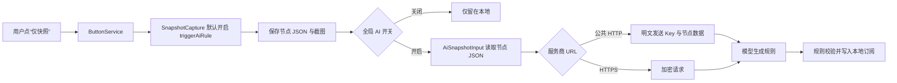

# GKD-XA 源码整体审查报告

> 审查日期：2026-11-25
> 审查基线：GitHub 84593320z/GKD-XA 的 main，commit 8095c633e95b0b82adc8c41a9cf0df6de9937a8e（2026-11-21）
> 目标版本：1.5.4 / versionCode 155
> 方法：远端源码静态审查、调用链核对、现有测试与 CI 契约检查
> 范围：对隔离克隆 GKD-XA-audit-8095c633 审查；没有修改应用源码，没有调用 AI 服务商、安装 APK 或连接 Android 设备。

## 1. 执行摘要

已确认用户报告的行为：快照按钮菜单的“仅快照”执行 SnapshotCapture.capture()，而该函数默认 triggerAiRule=true。当全局“启用 AI 规则”开关开启时，即使选了“仅快照”，仍会把快照节点 JSON 提交给队列、请求配置的 AI 服务商并可能将规则写入本地订阅。这是最高优先级的功能/隐私/费用不一致项。

另确认公共明文 HTTP AI 地址不会被阻止；请求将 API Key 放在认证头，并把快照 JSON 发给该地址。对公共 HTTP，这意味着同网络观察者可能读到 API Key 和页面节点信息。建议作为发布前安全修复。

还有三处帮助说明不符实际：加强模式并不是“双击”触发；其生成/验证最多两次，未验证的候选仍可能被保存；当前请求只发送节点 JSON，帮助却称截图图片会发送给 AI。整体审查中没有发现已验证的 ZIP 路径穿越或诊断包密钥脱敏问题；相关区域有明确边界和测试。

| 编号 | 严重度 | 主题 | 状态 / 置信度 |
|---|---|---|---|
| F-01 | 中 (P2) | “仅快照”仍触发 AI 生成 | 源码已验证 / 高 |
| F-02 | 中 (P2) | 公共 HTTP 可发送 API Key 与快照内容 | 源码已验证 / 高 |
| F-03 | 低 (P3) | “双击加强模式”与实际菜单操作不符 | 源码已验证 / 高 |
| F-04 | 中 (P2) | “图片会发送给 AI”与纯 JSON 输入不符 | 源码已验证 / 高 |
| F-05 | 中 (P2) | “直到命中”与两次尝试、未验证保存行为不符 | 源码已验证 / 高 |
| R-01 | 建议 | 加强模式会实际执行模型给出的界面动作 | 设计风险 / 高（未在设备复测） |
| R-02 | 低 / 信息 | 完整备份包含 AI 服务商密钥，备份文件未加密 | 源码已验证 / 高 |

## 2. 审查范围和限制

- 直接克隆 GitHub 仓库并确认本地 HEAD 与远端 main HEAD 一致；审查基线为 commit 8095c633e95b0b82adc8c41a9cf0df6de9937a8e。
- 本地 docs/audit-scope.md 是 2026-11-16 的 v1.5.2 维护/修复范围，不是本次审查的授权依据或当前代码事实。报告只针对用户要求的公开 GitHub 源码做静态审查；没有对外部服务进行主动安全测试。
- 仓库 CI 定义了 gkd-priv-ui:testDebugUnitTest、gkd-app:testGkdDebugUnitTest、gkd-selector:jvmTest、gkd-db:jvmTest 及优化 APK 构建。本次**没有成功运行 Gradle 测试**：仓库中的 gradle-wrapper.jar 存在且 ZIP 头有效，但通过当前 Windows/DSH 执行器启动 Java 时仍收到“Unable to access jarfile”；本次无法从该执行器环境确定具体原因。Semgrep 未安装。结论基于源码，不声称测试通过；仍应在正常 CI/Android 环境复测。
- 远端 CI 工作流本身保留测试门禁；本次没有触发 workflow 或发布。

## 3. 核心发现

### F-01：“仅快照”仍会调用模型

- **严重度**：中 (P2，功能/隐私/费用)；**置信度**：高；**状态**：源码已验证。
- **证据链**：悬浮按钮菜单中“仅快照”调用 SnapshotCapture.capture()，未明确传入关闭 AI 的参数；capture 的 triggerAiRule 默认值为 true；保存成功后，只要全局 aiEnable 为真就异步调用 AiRuleGenerator.generateRule(snapshot.id)。设置页也把全局开关说明为“保存快照后按当前服务商自动生成规则”。
- **影响**：按钮名称承诺仅拍快照，但用户选择后仍可能把节点数据发送给第三方、产生用量/费用并修改本地订阅。凡直接使用 capture 默认参数的快照入口，也继承这一默认行为。
- **复现**：启用 AI 规则并配置服务商 → 打开快照按钮菜单 → 点“仅快照” → 观察模型请求/AI 任务提示及本地订阅变化。静态路径已确认；本次未用真实服务商做网络复测。
- **位置**：[ButtonService.kt](../gkd-app/src/main/kotlin/li/gkd/app/service/ButtonService.kt#L69-L70)、[SnapshotCapture.kt](../gkd-app/src/main/kotlin/li/gkd/app/snapshot/SnapshotCapture.kt#L239-L250)、[SnapshotCapture.kt](../gkd-app/src/main/kotlin/li/gkd/app/snapshot/SnapshotCapture.kt#L329-L334)、[AdvancedPage.kt](../gkd-app/src/main/kotlin/li/gkd/app/feature/settings/AdvancedPage.kt#L148-L159)。
- **建议**：为捕获 API 使用显式动作模式，不用有副作用的默认参数。纯快照设 triggerAiRule=false；只有“快照并生成规则”显式启用 AI。优先使用 CaptureMode.SnapshotOnly / SnapshotAndGenerate / Enhanced 穷尽枚举。按用户建议可移除“加强模式”，把菜单改为“仅快照”“快照并生成规则”，使语义直接。

### F-02：公共明文 HTTP 会发送 API Key 和快照内容

- **严重度**：中 (P2，用户配置公共 HTTP 后的条件风险)；**置信度**：高；**状态**：配置与请求源码路径已验证，未进行网络动态拦截。
- **证据链**：
  1. [AiApiUrls.kt](../gkd-app/src/main/kotlin/li/gkd/app/util/AiApiUrls.kt#L236-L257) 对 http:// 公网地址返回 PUBLIC_HTTP_HINT，但这是建议，不是拒绝条件。
  2. [AiProviderDraft.kt](../gkd-app/src/main/kotlin/li/gkd/app/feature/settings/ai/AiProviderDraft.kt#L54-L69) 明确忽略此提示，保存/测试不拦；[AiRuleGenerator.kt](../gkd-app/src/main/kotlin/li/gkd/app/util/AiRuleGenerator.kt#L281-L294) 生成入口也把该提示视为可通过；模型拉取页相同。
  3. [AiTransport.kt](../gkd-app/src/main/kotlin/li/gkd/app/util/AiTransport.kt#L47-L61) 把 Key 放入 Authorization: Bearer / api-key / x-api-key 请求头；请求体由 [AiRuleGenerator.kt](../gkd-app/src/main/kotlin/li/gkd/app/util/AiRuleGenerator.kt#L141-L184) 构造，包含快照 JSON。
  4. 应用的 [network_security_config.xml](../gkd-app/src/main/res/xml/network_security_config.xml#L1-L6) 全局允许明文流量，没有仅限本机的网络域规则。
- **影响**：使用公共 HTTP AI 地址时，网络路径上的运营商、公共 Wi-Fi 或中间人可读取/篡改 API 请求；API Key 可被窃取并用于账户滥用，节点树可能含当前应用个人信息。followRedirects=false 能避免把凭据跟随重定向发送，但无法保护原始 HTTP 连接。
- **建议**：默认硬拒绝非本机/非局域网 HTTP。若确实要允许，应在保存前及首次使用前展示逐服务商、明确确认：“凭据与快照会以明文发送”。收窄 Android 明文流量白名单，并确保校验提示被呈现且不能被后续调用点默默忽略。

### F-03：帮助页的“双击”与实际加强模式入口不符

- **严重度**：低 (P3，交互文案)；**置信度**：高；**状态**：源码已验证。
- **证据链**：[AiHelpPage.kt](../gkd-app/src/main/kotlin/li/gkd/app/feature/settings/ai/AiHelpPage.kt#L42-L45) 说“双击快照按钮进入加强模式”；实际 [ButtonService.kt](../gkd-app/src/main/kotlin/li/gkd/app/service/ButtonService.kt#L36-L43) 的短点击打开菜单，菜单项 [ButtonService.kt](../gkd-app/src/main/kotlin/li/gkd/app/service/ButtonService.kt#L68-L72) 才启动加强模式。长按会停止服务 [ButtonService.kt](../gkd-app/src/main/kotlin/li/gkd/app/service/ButtonService.kt#L43-L44)；触摸分发只调用单击/长按，没有双击模式事件 [OverlayWindowService.kt](../gkd-app/src/main/kotlin/li/gkd/app/service/OverlayWindowService.kt#L357-L405)。
- **影响**：用户会寻找不存在的手势，并误以为必须双击进入。
- **建议**：若保留菜单，改为“点快照按钮，在弹出的菜单中选择加强模式”；若移除此模式，删除相关帮助和菜单文案。

### F-04：模型收到的是节点 JSON，不是快照图片

- **严重度**：中 (P2，能力/隐私说明)；**置信度**：高；**状态**：源码已验证。
- **证据链**：帮助页建议优先选“支持视觉输入”的模型，并说“快照图片会发送到你所配置的接口地址” [AiHelpPage.kt](../gkd-app/src/main/kotlin/li/gkd/app/feature/settings/ai/AiHelpPage.kt#L46-L52)。实际 [AiSnapshotInput.kt](../gkd-app/src/main/kotlin/li/gkd/app/util/AiSnapshotInput.kt#L13-L38) 读取、裁剪 snapshotFile 的 JSON；[ComplexSnapshot.kt](../gkd-app/src/main/kotlin/li/gkd/app/data/ComplexSnapshot.kt#L8-L20) 中有 app/activity/device 元数据及节点列表；[AiRuleGenerator.kt](../gkd-app/src/main/kotlin/li/gkd/app/util/AiRuleGenerator.kt#L141-L184) 仅把一段文本放进 Chat、Responses 或 Anthropic 请求，没有图片、多模态内容块或 base64。截图分享/上传是另一条 GitHub 流程，不是 AI 请求。
- **影响**：视觉模型看不到截图；界面只有图形、没有可访问节点信息时，当前模型无法依据图片生成规则。图片隐私文案也让用户误判图片已传出。
- **建议**：把说明改成“目前发送快照节点 JSON，不包含截图；模型依赖节点文本/控件属性”，并移除“必须选择视觉模型”指导。实现视觉能力前，补充多模态请求、大小限制、隐私提示及协议测试。

### F-05：加强模式只尝试两次，不是“直到命中”

- **严重度**：中 (P2，功能说明/用户预期)；**置信度**：高；**状态**：源码已验证。
- **证据链**：帮助文案承诺“若界面没有变化则让模型自动重写，直到命中为止” [AiHelpPage.kt](../gkd-app/src/main/kotlin/li/gkd/app/feature/settings/ai/AiHelpPage.kt#L42-L45)。实现只有 for (attempt in 0 until 2) 两次请求 [AiRuleGenerator.kt](../gkd-app/src/main/kotlin/li/gkd/app/util/AiRuleGenerator.kt#L367-L389)。
- **影响**：两次验证都不命中时，仍会把最近一次通过结构校验的候选插入本地订阅，并提示“规则未通过自动验证，已保存供手动调整” [AiRuleGenerator.kt](../gkd-app/src/main/kotlin/li/gkd/app/util/AiRuleGenerator.kt#L363-L365)、[AiRuleGenerator.kt](../gkd-app/src/main/kotlin/li/gkd/app/util/AiRuleGenerator.kt#L399-L405)。自动保存不代表规则已命中。
- **建议**：如移除加强模式，删除相关说明和入口；如保留，改成“最多尝试两次；未命中时保存候选供手动调整”，UI 明确标记“未验证”。

## 4. 风险与优化建议（非新增已确认漏洞）

### R-01：加强模式会执行模型生成的真实动作

该模式不是仅预览选择器。验证器在匹配后调用 perform(rule, target) [AiEnhancedVerification.kt](../gkd-app/src/main/kotlin/li/gkd/app/util/AiEnhancedVerification.kt#L43-L51)，实际连接到 rule.performAction(target).result [AiRuleGenerator.kt](../gkd-app/src/main/kotlin/li/gkd/app/util/AiRuleGenerator.kt#L408-L422)。AI 导入会接纳 click、clickNode、clickCenter、longClick、longClickNode、longClickCenter、back、swipe 等动作；验证路径实际调用规则动作执行器 [GkdAction.kt](../gkd-app/src/main/kotlin/li/gkd/app/data/GkdAction.kt#L34-L195)、[GkdAction.kt](../gkd-app/src/main/kotlin/li/gkd/app/data/GkdAction.kt#L207-L285)、[AiRuleImport.kt](../gkd-app/src/main/kotlin/li/gkd/app/util/AiRuleImport.kt#L47-L53)。代码会复核 app/activity/window/节点变化，但这不构成无副作用沙箱。若移除加强模式，应一并移除实时执行链，而不只是隐藏 UI；若保留，首次进入前应说明动作会实际作用于前台应用，并提供纯预览/手动确认。

### R-02：完整备份包含 AI 服务商密钥

AiConfig.apiKey 是普通字符串 [SettingsStore.kt](../gkd-app/src/main/kotlin/li/gkd/app/data/settings/SettingsStore.kt#L45-L74)。完整备份捕获 store 配置及订阅 [BackupManager.kt](../gkd-app/src/main/kotlin/li/gkd/app/data/backup/BackupManager.kt#L45-L56)，再将文本写入 ZIP [BackupManager.kt](../gkd-app/src/main/kotlin/li/gkd/app/data/backup/BackupManager.kt#L124-L143)。帮助页说日志/分享链接中的 Key 会脱敏，却没有说明完整备份仍包含服务商 Key [AiHelpPage.kt](../gkd-app/src/main/kotlin/li/gkd/app/feature/settings/ai/AiHelpPage.kt#L50-L52)。这属于完整配置备份的可预期行为，并非其他应用可直接读取私有目录；但分享备份文件即会一起分享 API Key。建议在完整备份导出前提示，提供排除密钥或加密备份选项。

### 4.1 已审查且有正向控制的区域

- 诊断包有预算、拒绝符号链接、过滤恢复/凭据文件；完整 JSON 递归脱敏自定义认证头值 [DiagnosticFiles.kt](../gkd-app/src/main/kotlin/li/gkd/app/data/backup/DiagnosticFiles.kt#L11-L42)、[DiagnosticBudget.kt](../gkd-app/src/main/kotlin/li/gkd/app/data/backup/DiagnosticBudget.kt#L33-L70)。已有 [DiagnosticFilesTest.kt](../gkd-app/src/test/kotlin/li/gkd/app/data/backup/DiagnosticFilesTest.kt) 相关测试。本审计没有认定诊断包泄漏密钥。
- ZIP 解压有条目/单文件/累计大小限制与 canonical path 检查 [ZipUtils.kt](../gkd-app/src/main/kotlin/li/gkd/app/util/ZipUtils.kt#L78-L142)；输入 ZIP 限制压缩文件大小 [BackupArchiveReader.kt](../gkd-app/src/main/kotlin/li/gkd/app/data/backup/BackupArchiveReader.kt#L16-L37)。
- AI 规则导入绑定预期 appId，限制单应用，拒绝 global groups、未知动作、空选择器、无效引用 [AiRuleImport.kt](../gkd-app/src/main/kotlin/li/gkd/app/util/AiRuleImport.kt#L13-L55)。
- 本地 HTTP 调试服务具备随机会话 token、Host/Origin 检查及鉴权测试 [DebugHttpSession.kt](../gkd-app/src/main/kotlin/li/gkd/app/service/DebugHttpSession.kt#L8-L47)、[DebugHttpSecurity.kt](../gkd-app/src/main/kotlin/li/gkd/app/service/DebugHttpSecurity.kt#L12-L51)、[DebugHttpSecurityTest.kt](../gkd-app/src/test/kotlin/li/gkd/app/service/DebugHttpSecurityTest.kt)。本次未动态测试运行时服务。
- APK 更新路径核验 package、签名、版本和可选摘要；本次未发现新增证据支持更新链绕过。

## 5. 修复优先级

1. **P2 / 尽快加固**：阻止公共 AI 明文 HTTP 或设计明确逐服务商风险确认；所有保存、模型拉取、普通生成、增强生成入口使用同一策略。
2. **P1 / 发布前**：快照按钮使用显式捕获模式；“仅快照”不得产生 AI 任务。生成规则必须由用户明确选择。
3. **P2**：若移除加强模式，删除运行时代码、菜单、帮助、旧测试中的陈旧行为；若保留，修正文案、披露重试上限/未验证结果并增加真实动作确认。
4. **P2**：对齐 AI 实际文本输入和视觉/隐私说明；目前只发送结构化节点 JSON。
5. **P3**：备份导出前说明其中含服务商密钥，提供排除或加密选项。
6. 增加入口矩阵测试：AI 开/关 × 仅快照/快照并生成/增强 × 悬浮按钮/快捷键/HTTP；断言仅明确选择生成动作时创建 AI 任务。

## 6. Evidence

### E-001：GitHub 基线
- observed_at: 2026-11-25
- source_type: command
- source_ref: git ls-remote --symref origin HEAD 与克隆目录 git rev-parse HEAD
- content_hash: Git commit 8095c633e95b0b82adc8c41a9cf0df6de9937a8e
- repro_command: git ls-remote --symref https://github.com/84593320z/GKD-XA.git HEAD
- raw_excerpt: refs/heads/main -> 8095c633e95b0b82adc8c41a9cf0df6de9937a8e

### E-002：快照按钮→AI任务调用链
- source_type: file / static call-flow
- source_ref: [ButtonService.kt](../gkd-app/src/main/kotlin/li/gkd/app/service/ButtonService.kt#L69-L70) → [SnapshotCapture.kt](../gkd-app/src/main/kotlin/li/gkd/app/snapshot/SnapshotCapture.kt#L244-L250) → [SnapshotCapture.kt](../gkd-app/src/main/kotlin/li/gkd/app/snapshot/SnapshotCapture.kt#L329-L334) → [AiRuleGenerator.kt](../gkd-app/src/main/kotlin/li/gkd/app/util/AiRuleGenerator.kt#L297-L315)
- content_hash: ButtonService 49874a8e5a49792acb005f9c665dc88cb666cc522a5cbda3d203a3160029e6c8；SnapshotCapture c0cbb3af0a38e2dfb129d13b88c2d419cdce59869ff46a058eabb9abe6dce099；AiRuleGenerator 055a32c8340c5fe3b7320cd62657e119e959158968612f8934d64709fa160561
- repro_command: 检索 triggerAiRule、调用默认 SnapshotCapture.capture() 的入口；追踪默认参数和 if (triggerAiRule && storeFlow.value.aiEnable)。
- raw_excerpt: triggerAiRule 默认 true；捕获保存后若 AI 开关为真就调用 AiRuleGenerator.generateRule(snapshot.id)。

### E-003：公共 HTTP 凭据数据流
- source_type: file / static data-flow
- source_ref: [AiApiUrls.kt](../gkd-app/src/main/kotlin/li/gkd/app/util/AiApiUrls.kt#L236-L257)、[AiProviderDraft.kt](../gkd-app/src/main/kotlin/li/gkd/app/feature/settings/ai/AiProviderDraft.kt#L51-L69)、[AiRuleGenerator.kt](../gkd-app/src/main/kotlin/li/gkd/app/util/AiRuleGenerator.kt#L281-L294)、[AiTransport.kt](../gkd-app/src/main/kotlin/li/gkd/app/util/AiTransport.kt#L47-L87)、[network_security_config.xml](../gkd-app/src/main/res/xml/network_security_config.xml#L1-L6)
- content_hash: AiApiUrls 69c38a52a89afc8661836fecec993a6b9be9b09e9b2745aafacaa24eee957b91；AiProviderDraft 53c3bae64abdd1766ab7347f747cb74402debcee95ef22547bf1322a4d51c025；AiTransport b864e44fc5cd1f3916bd0c36b6ee96e2ccf089dcbf8a678b0ce12dfc389339cc；network config 53900425733b69fd8b9b19fd2e4f8aa3b93b43deef6968c3d27ccfe71b0c7ee2
- repro_command: 对照 validateAiConfig 返回值、保存/测试/生成调用点和 applyAiHeaders；公共 HTTP 的 hint 可通过，Key 仍进入认证头。
- raw_excerpt: draft 只拒绝非空且非 PUBLIC_HTTP_HINT 的错误；普通协议设置 Authorization: Bearer apiKey。

### E-004：模式、图片和重试说明差异
- source_type: file / static comparison
- source_ref: [AiHelpPage.kt](../gkd-app/src/main/kotlin/li/gkd/app/feature/settings/ai/AiHelpPage.kt#L42-L52)、[ButtonService.kt](../gkd-app/src/main/kotlin/li/gkd/app/service/ButtonService.kt#L36-L72)、[OverlayWindowService.kt](../gkd-app/src/main/kotlin/li/gkd/app/service/OverlayWindowService.kt#L357-L405)、[AiSnapshotInput.kt](../gkd-app/src/main/kotlin/li/gkd/app/util/AiSnapshotInput.kt#L13-L38)、[AiRuleGenerator.kt](../gkd-app/src/main/kotlin/li/gkd/app/util/AiRuleGenerator.kt#L367-L405)
- content_hash: AiHelpPage 9345da9516a599c246fe3d9fb0a730c0b7ed1bf084766c2bd995c3084dfedadd；AiSnapshotInput cf83f1e98304964e92d7784a49fa7e38c813045253125bfc7f017d73c0f9b58c
- repro_command: 对比帮助文字与触摸分发、请求体构造和固定尝试上限。
- raw_excerpt: 文案称“双击”“图片会发送”“直到命中”；源码是单击展开菜单、文本 JSON 请求和 for (attempt in 0 until 2)。

### E-005：测试/CI 契约
- source_type: file / command
- source_ref: [Build-Apk.yml](../.github/workflows/Build-Apk.yml#L29-L40)、[Build-Release.yml](../.github/workflows/Build-Release.yml#L27-L37)、[AiSnapshotInputTest.kt](../gkd-app/src/test/kotlin/li/gkd/app/util/AiSnapshotInputTest.kt)、[AiApiUrlTest.kt](../gkd-app/src/test/kotlin/li/gkd/app/util/AiApiUrlTest.kt)
- content_hash: Build-Apk ca87c7d70c7543591f0ad602c04f7ff26f8ba40e5994fa3cd9719f286805a3f1；Build-Release da568a79e77ed0c02a5b71d60c5a117831797948c2f83450f1efc5af43fc1002
- repro_command: ./gradlew gkd-priv-ui:testDebugUnitTest gkd-app:testGkdDebugUnitTest gkd-selector:jvmTest gkd-db:jvmTest --stacktrace
- raw_excerpt: CI 有 Gradle 测试门禁；本机会话未能运行，Java 无法通过当前执行器访问 Wrapper JAR，未得到测试断言结果。

## 7. Findings

### F-001
- title: “仅快照”仍触发 AI 请求
- severity: medium
- category: functional / privacy
- status: validated (source path)
- evidence_ids: [E-001, E-002]
- location: ButtonService.kt:69; SnapshotCapture.kt:244-250, 329-334
- impact: 请求模型、消耗配额并可能写入规则，违背菜单动作含义。
- confidence: high
- remediation: 显式捕获模式；纯快照不得产生 AI 任务；增加所有入口矩阵测试。

### F-002
- title: 可向公共 HTTP 服务明文发送认证凭据和快照数据
- severity: medium
- category: misconfig / information disclosure
- status: validated (source data-flow; no live MITM performed)
- evidence_ids: [E-001, E-003]
- location: AiApiUrls.kt:236-257; AiProviderDraft.kt:51-69; AiRuleGenerator.kt:281-294; AiTransport.kt:47-87; network_security_config.xml:1-6
- impact: 网络中间人可窃取 Key、读取或篡改页面节点请求。
- confidence: high
- remediation: 默认拒绝公共 HTTP；安全提示需显式确认；收窄明文网络许可。

### F-003
- title: 加强模式入口手势说明错误
- severity: low
- category: functional documentation
- status: validated (source/UI comparison)
- evidence_ids: [E-001, E-004]
- location: AiHelpPage.kt:42-45; ButtonService.kt:36-72; OverlayWindowService.kt:357-405
- impact: 用户会寻找不存在的双击操作。
- confidence: high
- remediation: 文案说明“点击按钮后选菜单项”，或移除旧模式说明。

### F-004
- title: 图片上传隐私说明不符合当前纯文本请求
- severity: medium
- category: functional documentation
- status: validated (request shape)
- evidence_ids: [E-001, E-004]
- location: AiHelpPage.kt:46-52; AiSnapshotInput.kt:13-38; AiRuleGenerator.kt:141-184
- impact: 视觉模型看不到截图，图片传输提示造成错误隐私认知。
- confidence: high
- remediation: 说明当前只发送节点 JSON；实现并验证多模态前不要宣称发送图片。

### F-005
- title: 加强模式最多两次请求而非“直到命中”
- severity: medium
- category: functional documentation
- status: validated (source control-flow)
- evidence_ids: [E-001, E-004]
- location: AiHelpPage.kt:42-45; AiRuleGenerator.kt:367-405
- impact: 未命中但结构合法的候选仍会保存到本地规则。
- confidence: high
- remediation: 移除加强模式，或如实说明两次上限、未验证标记及候选保存行为。

## 8. Path / 关键调用流

### P-001：快照按钮到远端模型及规则落库

- path_type: callflow
- start: 用户点击“仅快照”
- goal: 保存快照、可能触发模型请求、写入本地订阅
- steps:
  1. ButtonService 的菜单项调用默认 SnapshotCapture.capture() — E-002 / F-001。
  2. 默认 triggerAiRule=true；保存成功后检查全局 AI 开关并异步生成规则 — E-002 / F-001。
  3. generateRule 读取完整快照 JSON 并调用 AiTransport — E-003/E-004 / F-002/F-004。
  4. 结构有效时合并规则；增强模式验证时会先执行 UI 动作 — R-01。
- residual_risks: 未连接真实服务商或设备；公共 HTTP 影响取决于用户设置及实际网络路径。

## 9. 时间线摘要

- 2026-11-25：确认 GitHub main commit 8095c633；克隆到隔离目录。
- 2026-11-25：静态追踪快照按钮、捕获 API、AI 输入、HTTP transport、规则校验/执行、备份与 CI 测试契约。
- 2026-11-25：尝试运行 Gradle 回归，但 Windows/JVM wrapper 路径访问失败；记录验证限制，未修改业务代码。

## 10. 复现建议与后续验收

1. 测试环境使用可观察请求计数的 mock AI 服务；AI 开启后分别选“仅快照”和“快照并生成规则”，断言仅后者发送一次模型请求并写规则。
2. 用 HTTP mock 捕获请求头/正文；验证公共 HTTP 在拒绝或显式确认之前不发送 Key/快照，HTTPS 仍正常。
3. UI 测试验证真实步骤是点击按钮→菜单→选择模式，不应声称双击。
4. 验证请求体不含 screenshot bytes；未来若加图像输入，再测各协议多模态、大小限制和隐私提示。
5. 若加强模式保留，构造两轮都未命中场景；断言 UI 标注未验证，且候选保存策略与说明一致。

---

**结论**：优先修复 F-01“仅快照”副作用与 F-02公共明文 HTTP 凭据风险。F-03–F-05 是可确认的界面、实现与说明不一致。当前 AI 输入是节点 JSON，不是屏幕截图。本报告不替代 CI/真机验收。
